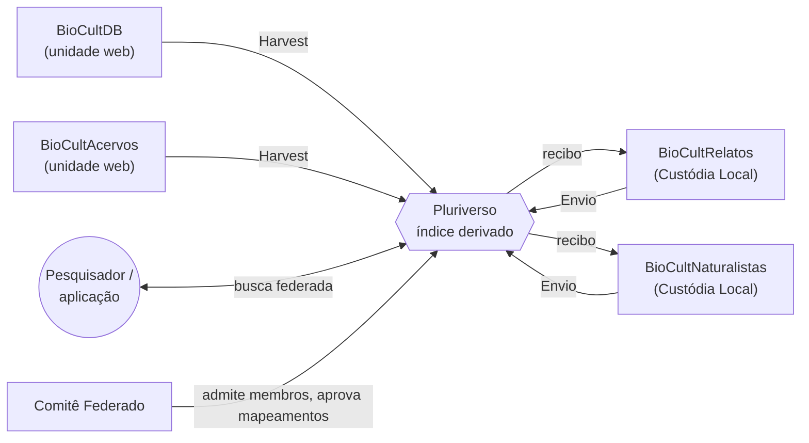
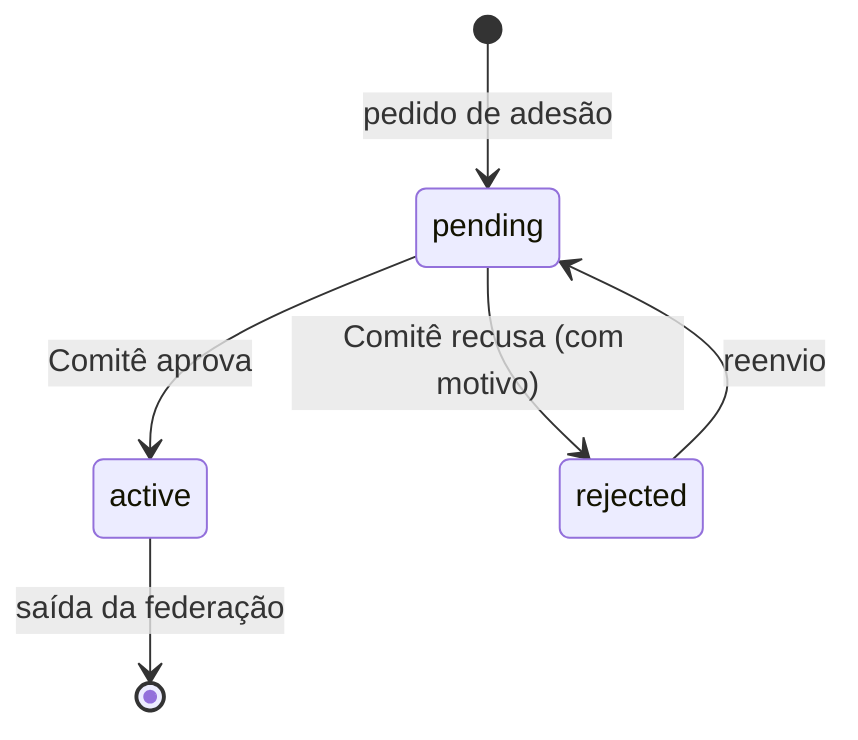

# Pluriverso

Proposta do **índice federado** da [Arquitetura BioCultural](https://github.com/edalcin/Arquitetura-BioCultural): reúne, para busca integrada, os registros públicos que cada Unidade Federada decide publicar, sem ser dona de nenhum deles.

> **Status: proposta, sem implementação; aberta a quem quiser assumir.** Este repositório só tem documentação. Nenhuma tecnologia está definida; a escolha cabe a quem implementar. Conforme o [ADR-021](https://github.com/edalcin/Arquitetura-BioCultural/blob/main/docs/tecnico/architecture-decisions/ADR-021-escopo-de-implementacao.md), o único caso implementado da federação é o BioCultDB integrado ao BioCultTermos; o Pluriverso mostra como a arquitetura poderia ser realizada no futuro.

> "Se os dados não estão fisicamente sob o controle de quem os gerou, a soberania é apenas uma promessa bonita em um termo de consentimento."
>
> — Eduardo Dalcin, em [*Sementes Livres, Solos Próprios*](https://eduardo.dalc.in/por-que-o-conhecimento-tradicional-exige-uma-arquitetura-federada/).

## O que é

O nome vem do "pluriverso": não um universo único e centralizado, mas a coexistência de vários mundos autônomos que se relacionam sem se subordinar. Cada Unidade Federada (BioCultDB, BioCultRelatos, BioCultAcervos, BioCultNaturalistas) é soberana sobre seus dados e seu vocabulário (BioCultTermos). O Pluriverso **não é autoridade sobre dado algum**: guarda apenas um **índice derivado** dos registros `public`; a fonte da verdade fica sempre na unidade. Ver [ADR-004](https://github.com/edalcin/Arquitetura-BioCultural/blob/main/docs/tecnico/architecture-decisions/ADR-004-federated-architecture.md).

## Posição na federação

## Papel

- **Entrada por Harvest**: o Pluriverso busca, periodicamente, os registros `public` das unidades web. A iniciativa é dele. Formato no [contrato de harvest](https://github.com/edalcin/Arquitetura-BioCultural/blob/main/docs/tecnico/contrato-harvest.md) ([ADR-016](https://github.com/edalcin/Arquitetura-BioCultural/blob/main/docs/tecnico/architecture-decisions/ADR-016-contrato-de-harvest.md)). O que deixou de ser publicado sai do índice.
- **Entrada por Envio**: nas unidades em Custódia Local, quem provê manda os registros `public`. A via é única: o Pluriverso devolve recibo, nunca dado ([ADR-018](https://github.com/edalcin/Arquitetura-BioCultural/blob/main/docs/tecnico/architecture-decisions/ADR-018-custodia-local-e-envio.md)).
- **Regime e acesso**: o índice preserva o Regime Enunciativo (Conhecimento ou Evidência) e o nível efetivo de acesso de cada registro, com a supressão de rótulos declarada, nunca omitida ([ADR-015](https://github.com/edalcin/Arquitetura-BioCultural/blob/main/docs/tecnico/architecture-decisions/ADR-015-regime-enunciativo-e-rotulagem-de-acesso.md)).
- **Mapeamento entre vocabulários**: cada unidade tem o seu BioCultTermos soberano. O Pluriverso não hospeda vocabulário; mantém mapeamentos SKOS-XL (`exactMatch`, `closeMatch`, `broadMatch`) entre vocabulários de unidades diferentes, aprovados pelo Comitê Federado e nunca impostos ([ADR-004](https://github.com/edalcin/Arquitetura-BioCultural/blob/main/docs/tecnico/architecture-decisions/ADR-004-federated-architecture.md) D2, [rótulos SKOS-XL](https://github.com/edalcin/Arquitetura-BioCultural/blob/main/docs/tecnico/rotulos-skos-xl.md)).
- **Consulta**: busca federada pública, com a origem de cada registro sempre atribuída e as licenças de cada unidade respeitadas.

## Admissão de membros

A unidade que quer entrar pede admissão pela interface pública do Pluriverso, sem precisar de Git. A verificação técnica do endereço informado é só um sinal; **a admissão nunca é automática**: só o Comitê Federado decide ([ADR-006](https://github.com/edalcin/Arquitetura-BioCultural/blob/main/docs/tecnico/architecture-decisions/ADR-006-federation-membership-protocol.md)).

## Topologia: várias instâncias

O Pluriverso não é singleton. Uma associação de comunidades pode ter o seu, federando só as suas unidades, sem depender de um índice global. Não há hierarquia entre instâncias, cada uma tem o seu Comitê Federado e uma mesma unidade pode ser indexada por várias. Ver [ADR-009](https://github.com/edalcin/Arquitetura-BioCultural/blob/main/docs/tecnico/architecture-decisions/ADR-009-pluriverso-multi-instance-topology.md).

## Princípios

| Princípio C.A.R.E. | No Pluriverso |
|---|---|
| **Collective Benefit** | O acesso integrado beneficia pesquisadores e as comunidades de todas as unidades |
| **Authority to Control** | A unidade decide o que publica; sai quando quiser e seus registros e mapeamentos saem do índice na hora, de forma auditável |
| **Responsibility** | Harvest, Envio, remoções e mapeamentos aprovados deixam registro auditável |
| **Ethics** | A origem de cada registro é sempre atribuída e nunca apagada; Labels e Notices são respeitados |

Não há acesso direto aos dados de ninguém além do que a unidade publica. O harvest autenticado para registros não `public` é extensão futura, sem decisão ([ADR-009](https://github.com/edalcin/Arquitetura-BioCultural/blob/main/docs/tecnico/architecture-decisions/ADR-009-pluriverso-multi-instance-topology.md)).

## Links

- [Arquitetura BioCultural](https://github.com/edalcin/Arquitetura-BioCultural) · [ADR-008 (motor de banco do índice, decisão de arquitetura)](https://github.com/edalcin/Arquitetura-BioCultural/blob/main/docs/tecnico/architecture-decisions/ADR-008-pluriverso-database-engine.md)
- [BioCultTermos](https://github.com/edalcin/BioCultTermos) · [BioCultDB](https://github.com/edalcin/BioCultDB)
- Propostas irmãs: [BioCultRelatos](https://github.com/edalcin/BioCultRelatos), [BioCultAcervos](https://github.com/edalcin/BioCultAcervos), [BioCultNaturalistas](https://github.com/edalcin/BioCultNaturalistas)
- [Próximos passos](docs/proximosPassos.md)
- Contato: [Issues](https://github.com/edalcin/pluriverso/issues) · edalcin@jbrj.gov.br

## Licença

[GPL-3.0](LICENSE).

## Agradecimentos

A formulação desta proposta não seria possível sem os diálogos de Viviane Fonseca (Jardim Botânico do Rio de Janeiro), Lucas Zelesco (Fundação Nacional dos Povos Indígenas) e dos membros do Comitê Gestor Useflora, cuja dedicação à salvaguarda da sociobiodiversidade e ao respeito às comunidades tradicionais inspirou este projeto.
